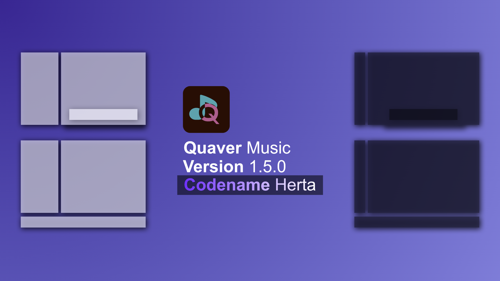
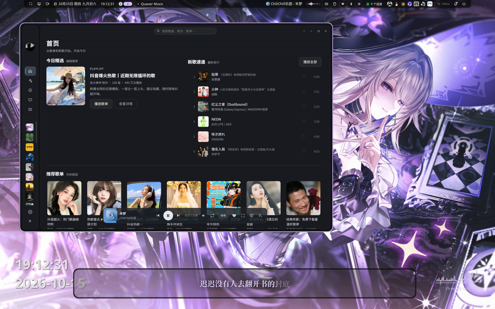
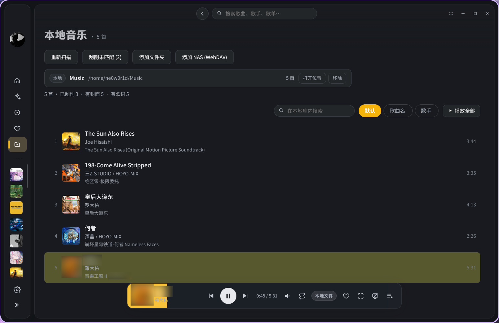
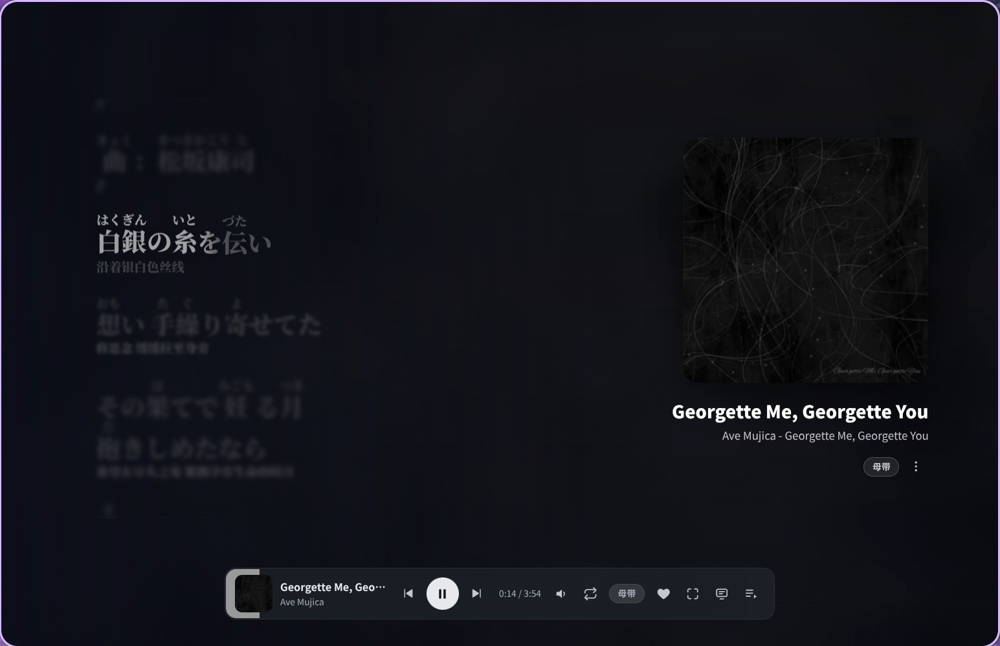
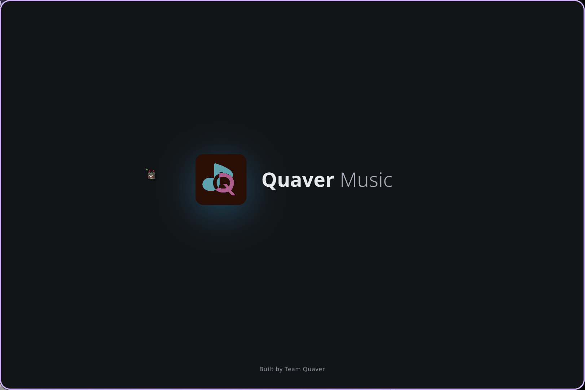
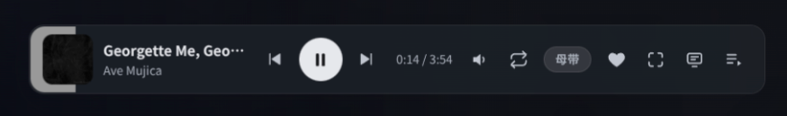

# 更新日志

## v1.5.0 Herta

欢迎来到 Quaver Music v1.5.0 Herta，在这个版本中，我们扩展了 Quaver Music 的功能，并经过多轮对话进行优化，修复。

### 特性

#### 新特性

- 这个版本中，我们支持了本地音乐，WebDAV NAS 的播放支持与刮削
  - 与此同时，本地音乐支持从本地导入封面/歌词
  - 在未来，我们将为我喜欢/本地音乐上线以歌手分类/以专辑分类。
  
#### 歌词

- AMLL 将成为 Quaver Music 内置的歌词渲染工具，不再以插件形式存在
- 支持了基于 Lyrics-Kit QRC Kana 的注音标记
	- 可能需要一定版本的修复和优化才能完善

- 歌词搜索已支持 AMLL 数据库获取
- 支持了桌面歌词
	- 该功能支持 TMLL 数据库，QRC，自导入（本地音乐）

- 支持歌词的延迟调节

- 实现了歌词繁体中文/简体中文转换（端侧）

#### 杂项

- NowPlaying：支持了歌词的音译优先/翻译优先功能

- Sparkle：我们移除了 AMLL 插件，将 AMLL 插件集合在 Quaver Music 里面
- Base：上线了启动动画

- UI：为 Quaver Design 实现了悬浮播放控制器
	- 该功能会为 Sparkle 开放支持

### 修复

- UI/DesktopLrc：自 Beta 1 版本发现的变成模态窗口问题现已修复
	- 该版本调整大小需通过右下角把手
- UI/Quaver Design：修复了 Quaver Design 下，播放列表被吸顶挡住的问题
	- 目前还在持续优化，预计在后面的修复包/功能更新带来
- Performance：自 Beta 1 发现的问题，现将歌词繁体/简体转换切分，并选择 Rolldown 分割
- UI/Quaver Design：自 Beta 2 发现的问题，修复了 Quaver Design 下，悬浮播放控制条遮挡播放列表和设置的问题
- UI/Quaver Design：自 Beta 2 发现的问题，修复了 Quaver Design 下，播放本地音乐会有进度条闪烁的回归问题
### 优化

- PlayControl: 单轮播放现已下线，请使用列表循环模式
- Performance：优化部分内存占用
- Performance：将部分页面实现动态加载
- UI/PlayControl：播放控制条的 like 按钮，现已变成空/实心单色
- UI/PlayControl：自 Beta 1 发现的问题，桌面歌词按钮现已不参与 tint
- UI/NowPlaying：我们为暂停/播放的封面实现了”呼吸效果“
- UI/Search： 搜索页已按照分页实现
- UI/客户端窗口装饰模式：现已优化正在播放页的的可拖动逻辑，可将鼠标放在右上角空白位置进行拖动
	- 由于位置冲突的问题，没法让整行 CSD 区甚至整个页面可拖动
	- 我们正在持续收取 UI 优化意见并加以考量

### 花火插件 SDK

- 现已支持透传本地音乐功能，以修复 Flowscope 的本地播放音质控制器
- 为正在播放页扩展更多 SDK
  
### 官方插件

#### Flowscope 流境

- Flowscope 已为本地播放进行优化
- Flowscope 已为列表循环模式进行修复

#### Lumen

- Lumen 已跟进新版花火插件 SDK

## v1.4.7

- 该版本修复了微信登录因后端使用浮点处理用户 ID，导致用户 ID 乱序获取到其他人的歌单等完全无法正常使用的 Bug [#22](https://github.com/Team-Quaver/quaver-music/issues/22)

## v1.4.6
- 由于系统包自动更新的这个逻辑在实际使用会很傻逼，故修改机制，可打开文件管理器/打开默认应用，默认更新包下载位置（除 AppImage），为用户下载目录

## v1.4.5

- 支持了两个新的环境变量
  - QUAVER_CROTCHET 该环境变量系调试模式，值需要是端口号，启动后可以无弹窗安装插件，在 Chrome 中进行调试
  - QUAVER_REDFLAG 该环境变量为安全模式，当值为非零时，除内置插件外，其他插件全部禁用且无法安装任何插件
- 该版本上线了 Deb、RPM 包的支持
- 移除了对 AppImage 管理器更新 AppImage 包导致 AppImage 版本死锁的问题
- 支持通过 XDG-Open 打开 Discover/GNOME Software 完成更新
- 该版本开始，将会尽力为星火 APM 和玲珑应用商店适配

## v1.4.1 - 1.4.4

### UI 修复

- 修复了 Quaver Design 的吸顶问题（v1.4.1）
- 修复了 UI 问题，该问题会导致搜索候选框会被吸顶界面覆盖（v1.4.3）
- 修复 UI 的一些异常阴影，并对 Flowscope 和 Lumen 插件做了一点修复（v1.4.4）

### 后端修复
- 修复了会员等级获取和 QQ 无法登陆的问题（v1.4.2）

## v1.4.0 Aemeath

欢迎来到 Quaver Music v1.4.0 Aemeath，这是 Quaver Music 百变的开始，也是持续进化的开始。

自该版本开始，Quaver Music 步入稳定阶段，也会持续重构一些影响体验的地方。

### 重构

- 为花火插件解放了一些硬编码 CSS 变量

### 功能

#### Quaver Design（默认主题）

- 现已支持背景自定义
- 现已支持菜单毛玻璃开关
- 现已支持高亮自定义
- 现已支持特定 Shell / 桌面环境高亮 Tint 

#### Sparkle（花火插件）

从设计 Sparkle 插件系统之初，就以百变的想法为主，在这个版本中，我们上线了 Sparkle 插件的中文名 - 花火插件，该名字取自《崩坏：星穹铁道》的花火，一个能代表“百变”的角色。

- 花火插件 SDK 现已继续扩展功能，主题系统可以改变多数的外观项，正在研究支持音源和 Discord 活动
- 花火插件现已支持宿主的功能让位
- 为避免低版本插件装为新宿主中出现的问题（如 Lumen 流光），SDK / 宿主现已可选的最小版本

#### 系统功能更新

- 自动更新现已加入 Beta 版本更新，每次大版本会按需提供 Beta 版本（即有开发代号的 X 和 Y）
### 优化

- Quaver Design 的 ContentView，现加入吸顶模式
- 优化 Quaver Design 的搜索栏与 CSD 以与吸顶接壤
- 优化设置页，让设置页标题和 Tab 固定，设置项全宽
- Quaver Design 自该版本后，背景默认设置为无
- Quaver Design 自该版本后，Tint 默认设置为青色

### Typhoeus-Go

- 现已支持如 DECO* 27 - 《モニタリング》 QMC 的高音质播放
  - 为资产、项目安全，该行为不会落盘，仅在内存完成

### 修复

- 修复了歌手页专辑因分页错误排序的问题（已 Cherry-Pick 到 1.3.5）
- 修复了因为 Json 值读取导致专辑内歌曲乱序的问题（已 Cherry-Pick 到 1.3.5）

### 官方插件更新

#### Flowscope 流境

- 现已支持多行歌词
- 优化多封面动画
- 移除了影响观感的歌词阴影

#### Lumen 流光

- 首次亮相，这是一个让 1.4 版本以上可美化成 Material Design 3 的主题插件，提供 Tint 系统
  - 已在 Noctalia 中测试
  - 同时能够影响 NowPlaying 与 Flowscope 插件

## v1.3.2 - 1.3.5

### 优化

- 优化了托盘上下文菜单歌曲信息过长的问题

### 修复
- 修复了 macOS 下潜在的 MPV 问题（由于 Mach-O 会对旧 OS 做 Breaking Change，故目前只支持 macOS 14 + ）
- 修复了 macOS 下 Tray 图标过大的问题
  - 我们因此统一了单色托盘图标
- 修复了由于 Electron 仅读 GTK 主题设置深浅色模式导致托盘图标无法变色的问题
- 修复了 Flowscope 流境插件的封面问题
- 修复了 Windows 托盘图标颜色翻转的 Bug
- 修复了歌手页专辑因分页错误排序的问题
- 修复了因为 Json 值读取导致专辑内歌曲乱序的问题

### 重构

- 前端所有 JavaScript 代码已全部迁移至 TypeScript

## v1.3.1 

- 修复了 Windows 环境下无法使用 Sparkle 插件的 Bug

## v1.3.0 Evanescia

该版本开发代号取自于《崩坏：星穹铁道》绯英，自该版本后，除进入 2.0 世代，不再使用大版本开发代号 Ellen

### 特性
- 支持 Tray 控制上下曲、循环模式、暂停
  - 未来可能会上线音量调节
- 支持了睡眠抑制功能（已在 Windows 和 Linux 测试）
- 支持了 AppImage / Windows 更新功能
- 支持了 Nightly & Stable 分支替换功能
- 启用了 Sparkle Marketplace 功能
- 支持了手动安装插件与手动安装插件警告

### Sparkle SDK

Sparkle SDK 于这个版本扩展，可支持更加百变的插件，扩展，详细可看 https://quaver.0w0.red/sparkle-dev.html

### 优化

- 由于启用了 Sparkle Marketplace，Sparkle 设置现已重新设计
- 音质获取不再前端完全显示，先嗅探，再前端做渲染
- 启用主题后，可在外观配置主题

### 全新官方插件

本次更新插件不遂包推送，请前往 Marketplace 下载

- Aura 夜挥
  - 主题/ CI 测试插件，深色模式改变配色方案的插件
- Flowscape 流境
  - 该插件提供了类似 iTunes Cover Flow 的体验，由于 Cover Flow 系苹果的商标，所以叫 Flowscape

## v1.2.2

- 修复了潜在的图标渲染问题

## v1.2.1 

### 优化

- 将歌单的双击和右键菜单逻辑加入至每日 30 首和我喜欢中
- 由于 Linux 的 Ctrl + Alt + F5 会跳转 TTY，故暂停全局快捷键为 Ctrl + Alt + P
- 修改部分文案

### 修复

- 修复了一个 TypeScript 的类型错误 `globalShortcut.isAccelerator`，该类型错误会导致 Windows 和 OS X 平台无法注册快捷键

## v1.2.0 Ellen / Phoebe

### Typhoeus-Go

Quaver Music 全新后端，Typhoeus-Go 现已正式上线！

原定 1.3 Ellen Eevanescia 版本上线，在经过打磨后，可提前到该版本

该版本的 Typhoeus 后端从 Python（L-1124/QQMusicAPI） 与 Typhoeus 迁移到基于 Go 语言的 Typhoeus-Go，欢迎后端开发者踊跃贡献！

链接：https://github.com/Team-Quaver/typhoeus-go

目前仅迁移与 QM 交互的相关部分，系统集成部分将会尝试从 TypeScript 迁移到 Golang（包括媒体控制 + 电源管理）

### 平台

- 由于 Golang 本体支持交叉编译，现在已试验性为龙芯 ABI 2.0 打包，使用 Electron 34

### 杂项

- 由于部分软件会将该应用认为系节奏游戏 Quaver，故该版本的 dist 名字现已改为 `Quaver Music`
- 由于部分桌面有严格的 XDG 桌面门户注册机制，故该版本的 AppID 现已改成 `red.0w0.quaver`

### 后端

- 现已支持臻品全景声 7.1（atmos71）播放，原定支持 Dolby Atmos 和 DTS:X 由于 MPV 解码器问题故不选择支持，未来如能实现 Go + FFmpeg 则再考虑。
- 现已试验性支持通过 QQ 音乐的会员门控播放会员能播的部分歌曲，非 QQ 音乐会员请勿汇报相关问题（如《视奸》）
  - 已知问题：目前只支持 HQ320 Ogg
  - 已知问题：加载速度会偏慢

### 特性

- 支持非 Karaoke 模式（关闭 AMLL 插件）后的文本大小调节
- 支持随机播放模式
- 支持音频信息流显示
- 支持歌单的快速插队/删除
- 支持全局快捷键（Linux 走 XDG 桌面门户，请确保桌面环境支持）

### 修复

- 修复了从歌单删除歌曲后，点击别的歌曲播放后却跳转到新对应偏好歌曲

### 已知问题

- 应用图标渲染有问题

## v1.1.2 Ellen / Cyrene End

### 优化

- 优化了歌单的热刷新的逻辑

## v1.1.1

### 优化

- 禁止了行为外点击跳转（新建多窗口，点击后键盘控制焦点仍在点击区域）
- 实现了上一首的逻辑设置，现可设置为
- 修复了音质菜单绑定播放控制器，而导致无法滚轮滚动选项的问题

## v1.1.0 Ellen / Cyrene

### 平台支持

- 现已支持以下新平台：
  - Windows x86-64
  - Windows on ARM
  - macOS Apple Silicon

由于 macOS AMD64 平台已经是 Legacy 平台，故决定不再维护，龙芯由于无构建机构建 PyInstaller，远端 QEMU 部署又过慢而不进行构建，正在筹备全新后端的版本，使用 Go 构建，[仓库在这](https://github.com/Team-Quaver/typhoeus-go)，将会于 1.2 Ellen Phoebe 或 1.3 Ellen Evanescia 中上线。

可在 v1.3.0-TyphoeusGo-Early-Alpha 版本中品鉴

--- 

### 特性

- Sparkle： Quaver Music 的插件系统，名字灵感来源于《崩坏：星穹铁道》角色花火，SDK 已开源（但并不完整）
  - Sparkle Marketplace 等待上线
- 现以支持 AMLL 插件化驱动的 QRC 逐字歌词系统
  - 在 dynamic lyrics 测试版中，使用的是集成 SPlayer 的 Lyrics-Kit + Lyrics-DOM，在考虑过后，选择了使用 AMLL
- 正在播放页（NowPlaying）现已经支持更多选项，翻译选项已经移动进去（支持同名搜索，跳转歌手、专辑）
- Linux：现已支持基于 XDG 桌面门户与 Logind 直连的睡眠抑制器
- Linux：现已支持通过桌面音量调节器管理播放器音量
- macOS/Windows：现已支持通过 Objective-C 实现 NowPlaying + C# 实现 SMTC
- 现已支持全屏（画廊）模式
  - 未来版本中，将会支持 Cover Flow 插件，复刻老版本 iTunes 的横屏设计

---

### 优化

- 减少了一部分死代码和内存泄漏导致的内存占用过高的 Bug，在 Linux 平台，该版本会比官方客户端内存占用少一半以上
- 已”屏蔽“ Chromium 默认焦点高亮系统，未来上线快捷键功能后将会禁用键盘操作（预计 Ellen Phoebe 上线的功能）
- 修复歌词的竞态问题

## v1.0.5 - Ellen / Chisa End

### MPV
- 加入了 MPV Watchdog，以避免注销/关机时 Quaver Music 依旧能放歌
- 优化了 CSD/SSD 切换时放曲的逻辑，现在不会因为窗口 Rebuild 而导致暂停播放

### UI
- 现已关闭 Tab 键焦点遍历

## v1.0.4

### 特性
- 加入主菜单栏与宽屏模式播放列表的拖动缩放

### 修复
- 修复了播放控制器 / 进度条的容器问题

### 优化
- 优化了搜索页双击插队的逻辑

## v1.0.3
### 修复

- 关闭主菜单栏的 CSS 超链接拖拽（遗留问题且觉得没用）
- 修复了页面的竞态问题

## v1.0.2
### 修复
- 修复安全问题

## v1.0.1
### 修复
- 修复了 RC 遇到的拖拽播放列表会因为选中文本导致无法排序的 Bug，现已禁止除输入框内选中文本

## v1.0.0-rc

#### 新特性
- 移植了 PR #12 的部分 UI 布局
- QQ 音乐子标题现已可渲染（如《半梦（Studio Live）》
- 支持展示 QQ 音乐会员过期时间
- 加入歌单控制
- 加入播放列表控制
- 加入右键菜单
- 加入插队功能
- 加入主菜单栏展开/收起功能

### 优化
- 退出后现可保留播放列表
- 每日 30 首功能现已可用
- 猜你喜欢现已优化无限电台功能获取歌单的远程逻辑

## v1.0.0-beta

### 特性

- 全局 Tint
- 全新 Playlist
- 动画系统

## v1.0.0-alpha-3

### 功能
- 加入设置持久化
- 加入自定义字体设置
- 引入 MPV 后端

### 修复

- 修复界面逻辑：可点击列表内其他歌手跳转
- 修复 Electron 超时问题

## Ellen Chisa Alpha 2

### 特性

- 完整的歌手页（待优化逻辑）
- 搜索功能
- 远端的收藏/红心功能

### 问题修复

- 歌词颜色回调

## Ellen Chisa Alpha 1

First Look Edition
